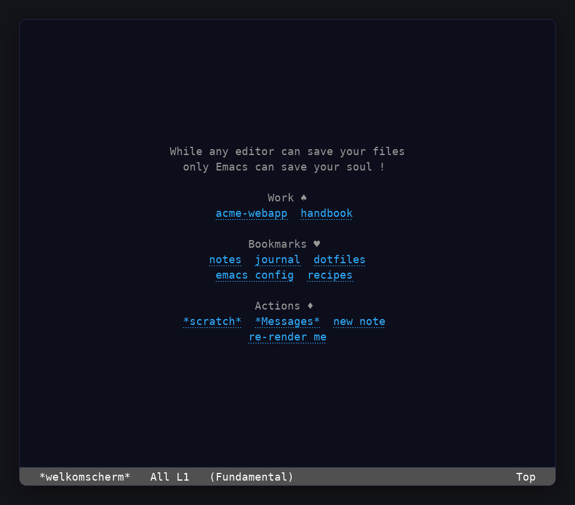
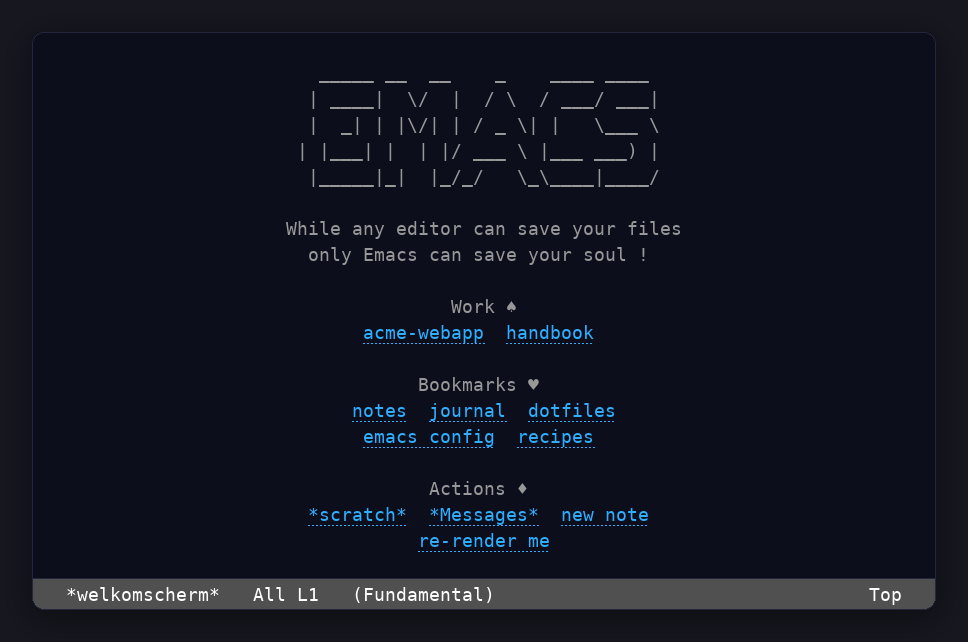
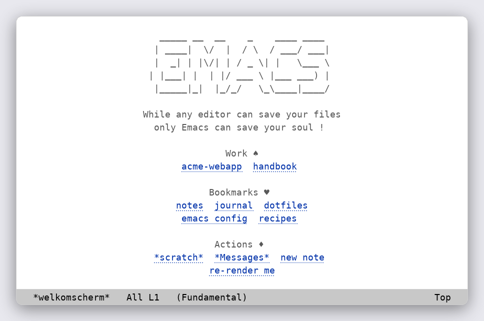
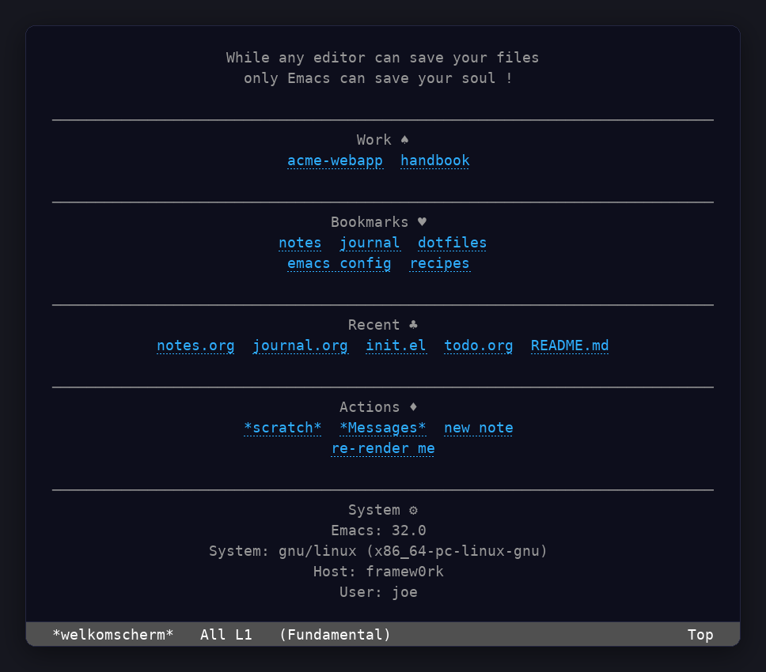
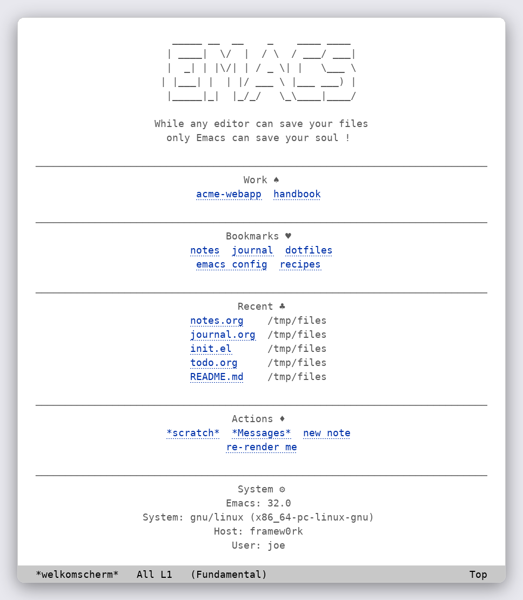

#+title: welkomscherm.el
#+subtitle: a quiet welcome screen for Emacs
#+author: Josep Bigorra
#+email: jjbigorra@gmail.com
#+language: en
#+options: toc:nil num:nil

[[https://jointhefreeworld.org/ggg/dist/emacs-lisp.svg]] [[https://jointhefreeworld.org/ggg/dist/license-gpl3+.svg]] [[https://jointhefreeworld.org/ggg/dist/license-fdl13+.svg]]

/welkomscherm/ is Dutch for *welcome screen*.

*welkomscherm.el is a small, calm, extensible welcome screen / dashboard for Emacs*: a centred handful of
lines, the links you actually use, and nothing that gets in your way. It greets
you in a graphical frame and in a plain terminal alike, on any Emacs from 25.1
upwards, and it asks nothing of you that Emacs does not already provide.

Extensible and configurable to your liking and following and respecting your themes out of the box and with customizable faces.

#+begin_quote
One screen, two themes, every section: the demo alternates between the default
view and one with separators, recent files and system details enabled, in a
dark and a light theme. The frames are drawn from the package's own buffer
output — see [[#showcase-and-screenshots][Showcase and screenshots]] for how,
and for more pictures.
#+end_quote

-------------------------

* Why welkomscherm ?
:PROPERTIES:
:CUSTOM_ID: why-welkomscherm
:END:

Every editor has a welcome screen; most of them try to be a cockpit. That is
wonderful when you want a cockpit, and tiring when you only want to feel at
home.

welkomscherm makes one promise: *a small, legible, beautifully centred screen
that you can read in a second and trust to keep working for the next fifty
years.* Concretely, that promise is kept by four choices.

- *No external libraries.* :: The whole package runs on Emacs built-ins alone.
  There is nothing to install alongside it and nothing to break when another
  package changes. The section separators are drawn by welkomscherm itself and
  re-flow with the window, so there is not even a rendering library to miss.
- *Tiny and auditable.* :: The entire package is a single file of a few hundred
  lines. You can read all of it on a coffee break, and you will understand all
  of it.
- *Composable sections.* :: Every block of the screen is a self-contained unit
  with its own heading, its own visibility rule and its own body. Adding,
  removing or reordering a section means editing one list — the list
  ~welkomscherm/sections~ — and nothing else.
- *One screen, two worlds.* :: The same buffer renders identically in GUI Emacs
  and in terminal Emacs, local or over SSH, because it is plain text and
  ordinary Emacs buttons rather than images and widgets.

* Features
:PROPERTIES:
:CUSTOM_ID: features
:END:

- *A welcome screen, not a cockpit.* :: Title, bookmarks, work links, action
  buttons, optional recent files, optional system details. Nothing else asks
  for your attention.
- *Composable sections.* :: Add, remove or reorder blocks of the screen by
  editing ~welkomscherm/sections~. A section can be one of the built-ins, a
  record you build with ~welkomscherm/make-section~, or a plain function of no
  arguments.
- *Self-drawn separators.* :: Opt-in horizontal rules that follow the centring
  axis of your text, re-flow on resize, and need no ~page-break-lines~ or any
  other package. See ~welkomscherm/use-separator~.
- *Clickable everything.* :: Bookmarks and actions are ordinary Emacs buttons,
  so ~mouse-1~, ~TAB~ and ~RET~ all work, in a GUI frame and in a terminal.
- *GUI and TUI parity.* :: No images, no widgets, no conditional code paths:
  the same screen on a laptop, a workstation, or a server console over SSH.
- *Opt-in extras.* :: Recent files (from the built-in ~recentf~) and system
  details are one flag away, and stay out of the way until you ask for them.
- *Startup honesty.* :: A small line tells you how long Emacs took to start,
  handy while tuning your configuration and easy to switch off afterwards.
- *Your private and work lives apart.* :: Separate bookmark lists for personal
  and work links, each arranged in rows, the way you would arrange a shelf.
- *Quiet by default.* :: The buffer is read-only, a little extra line spacing
  keeps it airy (user customizable via ~welkomscherm/line-spacing~), and point
  is left on the first line so you always see it from the top.
- *Free software, all the way.* :: GPL-3.0-or-later for the code, FDL-1.3+ for
  the docs. No telemetry, no network, no surprises.

* Ways to install
:PROPERTIES:
:CUSTOM_ID: ways-to-install
:END:

/Four routes to the same 1.2.2, from the most automated to the most manual.  They all build the tag this README documents./

** From the Guix channel
:PROPERTIES:
:CUSTOM_ID: from-the-guix-channel
:END:
*GNU Guix* is the functional package manager this project is developed with: a build is a pure function of its inputs, so the same recipe gives the same result everywhere, and an upgrade that goes wrong can be rolled back.

The jointhefreeworld channel carries ~emacs-welkomscherm~ at 1.2.2, so a checkout of the channel is enough — no package definition to write:

#+begin_src shell
git clone https://codeberg.org/jjba23/guix-jointhefreeworld.git
guix install -L ./guix-jointhefreeworld emacs-welkomscherm
#+end_src

Add the channel to ~$HOME/.config/guix/channels.scm~ (the channel's README has the four lines) and a plain ~guix install emacs-welkomscherm~ keeps working on every later ~guix pull~.

** From the Nix flake
:PROPERTIES:
:CUSTOM_ID: from-the-nix-flake
:END:
*Nix* offers the same declarative, reproducible model with its own language, its own store and a binary cache, and it is a natural fit if the rest of your machine is already described in Nix.

The jointhefreeworld flake builds this project with this repository's own expression, so the package cannot drift from the source:

#+begin_src shell
nix build github:jjba23/nix-jointhefreeworld#emacs-welkomscherm
#+end_src

The same attribute is available as an overlay, so ~pkgs.jointhefreeworld.emacs-welkomscherm~ works inside a NixOS or home-manager configuration too.

** As a container image
:PROPERTIES:
:CUSTOM_ID: as-a-container-image
:END:
*Podman or Docker* is the route that puts nothing on the host: the ~Dockerfile~ in this repository builds the project in a builder stage and copies only what it installed into a runtime stage, so the image is small and the host keeps its own toolchain untouched.

#+begin_src shell
podman build -t welkomscherm-el .   # docker build -t welkomscherm-el . also works
podman run --rm -it welkomscherm-el
#+end_src

The image's entry point is Emacs, with welkomscherm.el installed and byte-compiled, which makes it useful for a quick try and for reproducing a bug on a clean system.

** As a distribution package
:PROPERTIES:
:CUSTOM_ID: as-a-distribution-package
:END:
*Debian, openSUSE and Arch* each get the project through their own package manager.  Packaging lives in this repository under ~packaging/~ and is pinned to the same release tag, so the recipes and the sources they build are versioned together.

None of the three archives ships welkomscherm.el yet, so these are recipes to build rather than packages to install from a mirror:

| Distribution   | Package              | How to build it                                                                     |
|----------------+----------------------+-------------------------------------------------------------------------------------|
| Debian, Ubuntu | ~elpa-welkomscherm~  | copy ~packaging/debian~ to the repository root, then ~dpkg-buildpackage -us -uc -b~ |
| openSUSE       | ~emacs-welkomscherm~ | ~osc build~ with ~packaging/opensuse~                                               |
| Arch           | ~emacs-welkomscherm~ | ~makepkg -si~ in ~packaging/arch~                                                   |

Each recipe carries its own dependency list, so a missing library fails the build with its name rather than producing a package that cannot load.

** Which one?
:PROPERTIES:
:CUSTOM_ID: which-one
:END:
- *Guix* if you want the toolchain the project is tested with, and the ability to roll back a bad upgrade.
- *Nix* if the rest of your machine is already declarative; the flake pins nixpkgs and gives you a binary cache.
- *Container* if you only want to try the release, or reproduce a report on a machine that has nothing installed.
- *Distribution package* if you want the project managed by the same tool as the rest of your system, with its licence, manual page and launcher in the usual places.

* Installation
:PROPERTIES:
:CUSTOM_ID: installation
:END:

** Requirements
:PROPERTIES:
:CUSTOM_ID: requirements
:END:

- *GNU Emacs 25.1 or newer.* That is the whole list. welkomscherm has no
  external dependencies and does not require any part of Emacs that is not
  already there (no ~cl-lib~ beyond the bundled one, no icon package, no
  rendering library).
- *Optional:* ~recentf-mode~ if you want the recent files section to have
  something to show.

** Install with Elpaca and use-package (recommended)
:PROPERTIES:
:CUSTOM_ID: install-elpaca
:END:

The package is not (yet) available in popular Emacs repositories such as MELPA
or ELPA, so fetch it straight from the source of truth:

#+begin_src emacs-lisp
  (use-package welkomscherm
    :ensure (:host codeberg :repo "jjba23/welkomscherm.el" :branch "trunk")
    :bind (("C-c SPC SPC" . welkomscherm))
    :init
    (setopt welkomscherm/centered t
            welkomscherm/use-section-title t
            welkomscherm/use-separator nil)

    ;; A quiet two-line greeting.
    (setopt welkomscherm/top-title-list
          '("Make yourself comfortable."
            "Your files are right here."))

    (setopt welkomscherm/bookmarks-list
          '((("dotfiles" . "~/Dev/Personal/dotfiles/")
             ("notes" . "~/Dev/Personal/private-notes/")
             ("emacs config" . "~/Dev/Personal/dotfiles/users/joe/emacs/init.el"))
            (("second-row-api" . "~/Dev/Personal/second-row-api/README.md")
             ("second-row-ssr" . "~/Dev/Personal/second-row-ssr/"))))

    (setopt welkomscherm/work-list
          '((("my-work" . "~/Dev/Work/my-work/")
             ("hem-wiki" . "~/Dev/Work/hem-wiki/"))))

    (setopt welkomscherm/actions-list
          '((("*scratch*" . (lambda (btn) (switch-to-buffer "*scratch*")))
             ("*Messages*" . (lambda (btn) (switch-to-buffer "*Messages*")))
             ("re-render me" . (lambda (btn) (welkomscherm))))))

    ;; Offer a hand, only if you want it.
    (setopt welkomscherm/show-recent-files t
            welkomscherm/show-system-details nil))
#+end_src

Then simply call ~M-x welkomscherm~ whenever you want to come home. To make it
the first thing you see, see [[#welkomscherm-at-startup][Welkomscherm at startup]].

#+begin_quote
/A note on ~setopt~:/ it arrived in Emacs 29. If you run an older Emacs — and
welkomscherm is happy all the way back to 25.1 — use ~setq~ in place of
~setopt~ and everything else above stays the same.
#+end_quote

** Install by hand
:PROPERTIES:
:CUSTOM_ID: install-by-hand
:END:

Two lines are enough if you keep the file somewhere on your ~load-path~:

#+begin_src shell
  git clone https://codeberg.org/jjba23/welkomscherm.el ~/.emacs.d/site-lisp/welkomscherm.el
#+end_src

#+begin_src emacs-lisp
  (add-to-list 'load-path "~/.emacs.d/site-lisp/welkomscherm.el")
  (require 'welkomscherm)
#+end_src

** Install with package-vc (Emacs 29 and newer)
:PROPERTIES:
:CUSTOM_ID: install-package-vc
:END:

If you run Emacs 29 or newer, the built-in ~package-vc~ can fetch, build and
load it without any third-party package manager at all:

#+begin_src emacs-lisp
  (package-vc-install "https://codeberg.org/jjba23/welkomscherm.el")
#+end_src

Or interactively: ~M-x package-vc-install RET~ and paste the URL.

** Install with Nix
:PROPERTIES:
:CUSTOM_ID: install-with-nix
:END:

This repository carries the expression itself, ~default.nix~ next to
~welkomscherm.el~, so ~nix-build~ in this checkout builds the package. It is
also part of
[[https://codeberg.org/jjba23/nix-jointhefreeworld][nix-jointhefreeworld]],
the set of Nix packages for everything Jointhefreeworld. The set's
~emacsOverlay~ adds it to ~emacsPackages~, byte-compiled and with its
autoloads, so an Emacs that Nix builds gets it the way it gets any other
package:

#+begin_src nix
  let
    emacsPackages = pkgs.emacsPackages.overrideScope nix-jointhefreeworld.emacsOverlay;
  in
    emacsPackages.withPackages (epkgs: [ epkgs.welkomscherm ])
#+end_src

* Quick start
:PROPERTIES:
:CUSTOM_ID: quick-start
:END:

Under a minute, start to finish:

1. Put welkomscherm on your ~load-path~ and require it (see
   [[#installation][Installation]]).
2. Point it at a directory or file you open all day:

   #+begin_src emacs-lisp
     (require 'welkomscherm)
     (setq welkomscherm/bookmarks-list
           '((("org" . "~/org/") ("notes" . "~/notes.org"))))
   #+end_src

3. Run ~M-x welkomscherm~.

That is the whole tour. Everything below is refinement: what the screen shows,
how it is built, and how to make it yours.

* Welkomscherm at startup
:PROPERTIES:
:CUSTOM_ID: welkomscherm-at-startup
:END:

If you want the welcome screen to be your initial buffer whenever you start a
new Emacs (a GUI frame or a terminal one), add this to your Emacs
configuration:

#+begin_src emacs-lisp
  (setq initial-buffer-choice
        (lambda () (welkomscherm) (get-buffer welkomscherm/buffer-name)))
#+end_src

Note that if using ~use-package~ it's recommendable to apply this setting in
your ~(use-package emacs)~ declaration.

* Configuration
:PROPERTIES:
:CUSTOM_ID: configuration
:END:

Feel free to dive a little into the source code and explore all the
configuration options: every option is documented in its own docstring. Out of
the box, welkomscherm shows its top title, then your work and personal
bookmarks, your action buttons, and how long startup took.

Every option below belongs to the ~welkomscherm~ customization group and can be
set with ~setopt~, with ~setq~ on older Emacsen, or through
~M-x customize-group RET welkomscherm~.

** Look, buffer and titles
:PROPERTIES:
:CUSTOM_ID: look-buffer-and-titles
:END:

- ~welkomscherm/buffer-name~ (string, default ~"*welkomscherm*"~) ::
  The name of the buffer welkomscherm renders into. Change it only if another
  package wants that name.

- ~welkomscherm/centered~ (boolean, default ~t~) ::
  Whether text lines are centred. When nil, everything is drawn flush left,
  which some people prefer in narrow terminals.

- ~welkomscherm/use-section-title~ (boolean, default ~t~) ::
  Whether section headings are drawn. Turning it off keeps the blank-line and
  rule separation but hides the titles, for a quieter screen.

- ~welkomscherm/use-separator~ (boolean, default ~nil~) ::
  Whether a horizontal rule separates sections. The buffer keeps a plain form
  feed (the ~^L~ page break of a text file) and welkomscherm draws it as a rule
  using nothing but Emacs, so no rendering library is involved, and the rule
  re-flows by itself whenever the frame is resized. The old name
  ~welkomscherm/use-form-feed~ still works as an obsolete alias.

- ~welkomscherm/separator~ (character, default ~?─~) ::
  The character the rule is made of; try ~?=~, ~?*~ or ~?·~ for another
  texture.

- ~welkomscherm/separator-width~ (integer or nil, default ~nil~) ::
  How wide the rule is, in columns. ~nil~ follows the content and shares the
  text's centring axis: the rule spans ~fill-column~ columns, or the window
  when that is narrower.

- ~welkomscherm/top-title-list~ (list of strings) ::
  The lines of the top banner. Default: "While any editor can save your files"
  and "only Emacs can save your soul !". Make it say whatever feels like home.

- The heading options — ~welkomscherm/bookmarks-name~, ~welkomscherm/work-name~,
  ~welkomscherm/actions-name~, ~welkomscherm/recent-files-name~,
  ~welkomscherm/system-details-name~ and ~welkomscherm/init-time-name~ (all
  strings) :: Rename any section heading. The little suit and heart glyphs in
  the defaults are just text; replace them with nothing, or with your own
  favourite marks.

** Your links and buttons
:PROPERTIES:
:CUSTOM_ID: your-links-and-buttons
:END:

- ~welkomscherm/bookmarks-list~ (alist) ::
  The personal bookmarks. It is a list of *rows*; each row is a list of
  ~(ALIAS . PATH)~ pairs, and each alias becomes a button that opens its path.
  Rows let you put several links on one line, the way you would arrange a
  shelf:

  #+begin_src emacs-lisp
    (setopt welkomscherm/bookmarks-list
            '((("blog" . "~/org/blog.org") ("inbox" . "~/org/inbox.org"))
              (("photos" . "~/Pictures/"))))
  #+end_src

- ~welkomscherm/work-list~ (alist) ::
  The work bookmarks, in exactly the same shape as ~bookmarks-list~. Keeping
  personal and work links apart is a small kindness you do your future self.

- ~welkomscherm/actions-list~ (alist) ::
  Buttons that *do* something. It is a list of rows; each row is a list of
  ~(LABEL . FUNCTION)~ pairs, where the function is called with the clicked
  button as its only argument:

  #+begin_src emacs-lisp
    (setopt welkomscherm/actions-list
            '((("new note" . (lambda (btn) (find-file "~/org/inbox.org")))
               ("scratch"  . (lambda (btn) (switch-to-buffer "*scratch*"))))))
  #+end_src

** Optional sections
:PROPERTIES:
:CUSTOM_ID: optional-sections
:END:

Two sections are off by default, so that they never surprise you, and each
turns on with a single flag.

- ~welkomscherm/show-system-details~ (boolean, default ~nil~) ::
  When non-nil, a small section reports the running Emacs version, the
  operating system, the host and the user. Its rows come from
  ~welkomscherm/system-details-list~.

- ~welkomscherm/system-details-list~ (alist) ::
  Each entry is ~(LABEL . VALUE)~, where VALUE is either a string or a
  function of no arguments returning a string. The default rows are built from
  Emacs's own variables. Add your own, for instance to greet you by name:

  #+begin_src emacs-lisp
    (setopt welkomscherm/show-system-details t)
    (setopt welkomscherm/system-details-list
            '(("Emacs"  . welkomscherm/system-emacs-version)
              ("System" . welkomscherm/system-description)
              ("Host"   . system-name)
              ("User"   . welkomscherm/system-user-name)
              ("Mood"   . "ready to write")))
  #+end_src

- ~welkomscherm/show-recent-files~ (boolean, default ~nil~) ::
  When non-nil, lists the files you visited recently. The list is read from
  the built-in ~recentf-list~, so enable ~recentf-mode~ for it to fill up.
  Files that no longer exist on disk are skipped, so the section never offers
  you something that is gone.

- ~welkomscherm/recent-files-limit~ (integer, default ~5~) ::
  How many recent files to show. The section stays quiet when there is nothing
  to show, so it never leaves an empty heading behind.

#+begin_src emacs-lisp
  (setopt welkomscherm/show-recent-files t
          welkomscherm/recent-files-limit 5)
#+end_src

** Startup time
:PROPERTIES:
:CUSTOM_ID: startup-time
:END:

- ~welkomscherm/show-init-time~ (boolean, default ~t~) ::
  Whether to show how long Emacs took to start. Handy while you are tuning
  your configuration; turn it off once you are happy.

- ~welkomscherm/init-time-name~ (string, default ~"Emacs startup took τ"~) ::
  The heading for that value.

** The screen itself
:PROPERTIES:
:CUSTOM_ID: the-screen-itself
:END:

- ~welkomscherm/sections~ (list) ::
  The ordered list of sections to render — a mix of the built-in section
  records and any sections of your own. See
  [[#sections-the-building-block][Sections: the building block]].

- ~welkomscherm/top-title~, ~welkomscherm/work~, ~welkomscherm/bookmarks~,
  ~welkomscherm/recent-files-section~, ~welkomscherm/actions~,
  ~welkomscherm/system-details~, ~welkomscherm/init-time~ :: These are the
  built-in section records themselves. You rarely set them directly; you
  reference them when you compose ~welkomscherm/sections~, or when you want to
  reuse one of them next to a section of your own.

** Hooks
:PROPERTIES:
:CUSTOM_ID: hooks
:END:

- ~welkomscherm/pre-render-hook~ (hook) ::
  Run before the buffer is populated, with the welkomscherm buffer current.
  A natural place to adjust ~fill-column~ so that centring matches the width
  of your frame.

- ~welkomscherm/post-render-hook~ (hook) ::
  Run after the buffer is populated, with the welkomscherm buffer current.

Both are described with examples in [[#available-hooks][Available hooks]].

* Sections: the building block
:PROPERTIES:
:CUSTOM_ID: sections-the-building-block
:END:

Everything on the screen is a *section*. A section is a small record, built
with ~welkomscherm/make-section~, that knows three things:

- its *name* — the heading drawn above it. It can be a plain string, a
  function returning a string (so the heading follows customization made
  later), or ~nil~ for a section with no heading at all;
- its *render* function — a function of no arguments that grows the buffer;
- its *condition* — a function of no arguments; when it returns non-nil the
  section is shown, otherwise it is skipped entirely. ~nil~ means "always
  show".

The shared framing — the blank line, the optional separator and the heading —
is drawn for you by ~welkomscherm/render-section~, so a section body only ever
draws its own content. That is what makes sections independent: to add,
remove or reorder one, you never touch the rendering code.

The screen itself is simply the list ~welkomscherm/sections~, rendered in
order:

#+begin_src emacs-lisp
  welkomscherm/sections
  ;; => (welkomscherm/top-title welkomscherm/work welkomscherm/bookmarks
  ;;     welkomscherm/recent-files-section welkomscherm/actions
  ;;     welkomscherm/system-details welkomscherm/init-time)
#+end_src

Reorder that list to reorder your home screen; drop an element to retire a
section; add your own to make the screen truly yours. A section can even be a
plain function of no arguments, if that is all you need:

#+begin_src emacs-lisp
  (setopt welkomscherm/sections
          (list welkomscherm/top-title
                ;; A section of your own, built as a record.
                (welkomscherm/make-section
                 :name "Today"
                 :condition (lambda () (bound-and-true-p org-agenda-files))
                 :render (lambda () (welkomscherm/insert-muted "Make it a good one.")))
                ;; Or just a bare function.
                (lambda () (welkomscherm/insert-muted "and a warm cup of coffee"))
                welkomscherm/bookmarks
                welkomscherm/actions))
#+end_src

** The primitives you can draw with
:PROPERTIES:
:CUSTOM_ID: the-primitives-you-can-draw-with
:END:

A section body is ordinary Emacs Lisp: you may ~insert~ whatever you like. To
keep it looking like the rest of the screen, use welkomscherm's own helpers.

| Helper                            | What it does                                           |
|-----------------------------------+--------------------------------------------------------|
| ~welkomscherm/insert-muted~       | insert text in the muted face and centre the line      |
| ~welkomscherm/insert-new-line~    | end the current line                                   |
| ~welkomscherm/insert-spacer~      | insert the two-space gap between two buttons           |
| ~welkomscherm/insert-separator~   | insert a horizontal rule marker, followed by a newline |
| ~welkomscherm/maybe-separator~    | the same, only when separators are enabled             |
| ~welkomscherm/maybe-centered~     | centre the current line when ~welkomscherm/centered~   |
| ~welkomscherm/render-rows~        | draw rows of ~(ALIAS . PATH)~ buttons                  |
| ~welkomscherm/render-action-rows~ | draw rows of ~(LABEL . FUNCTION)~ buttons              |
| ~welkomscherm/render-section~     | draw one section, framing and all                      |

A slightly more ambitious section, with its own buttons:

#+begin_src emacs-lisp
  (welkomscherm/make-section
   :name "Capture"
   :render (lambda ()
             (welkomscherm/render-action-rows
              (list (list (cons "note" (lambda (btn) (find-file "~/org/inbox.org")))
                          (cons "task" (lambda (btn) (find-file "~/org/tasks.org"))))))))
#+end_src

* Available hooks
:PROPERTIES:
:CUSTOM_ID: available-hooks
:END:

welkomscherm.el allows you to run code arbitrarily both before it renders, as
well as after. You should feel free to customize this to your liking.

On the technical side, this means two hooks are made available,
~welkomscherm/pre-render-hook~ and ~welkomscherm/post-render-hook~.

Find here an example where we adjust the ~fill-column~ in the welkomscherm
buffer so that the dashboard gets centered properly according to the size of
the frame.

By default, without this, centering is based on your default ~fill-column~
(likely 70 char) due to ~(center-line)~.

#+begin_src emacs-lisp
  (add-hook 'welkomscherm/pre-render-hook
            (lambda () (setq-local fill-column (frame-parameter nil 'width))))
#+end_src

Find here an example of running arbitrary code after rendering:

#+begin_src emacs-lisp
  (add-hook 'welkomscherm/post-render-hook
            (lambda () (message "welkomscherm rendered successfully")))
#+end_src

* How welkomscherm compares
:PROPERTIES:
:CUSTOM_ID: how-welkomscherm-compares
:END:

The Emacs dashboard space is friendly and varied; each of these packages is a
good answer to a slightly different question. Read this table as a map rather
than a scoreboard: any of them may be the right home for you.

| Package              | Hard requirements             | What it gives you                                                                   | How you shape it                                  |
|----------------------+-------------------------------+-------------------------------------------------------------------------------------+---------------------------------------------------|
| *welkomscherm.el*    | Emacs ≥ 25.1 (nothing else)   | centred links, bookmarks, work, actions, recent files, system details, startup time | composable sections in one list                   |
| emacs-dashboard      | Emacs ≥ 27.1                  | banner, recent files, bookmarks, projects, agenda, registers                        | ~dashboard-items~ and ~dashboard-startupify-list~ |
| enlight              | Emacs ≥ 27.1 and ~compat~     | one fully custom string, plus optional text menus                                   | ~enlight-content~ and hooks                       |
| welcome.el           | Emacs ≥ 27.1 and ~nerd-icons~ | a banner header and a key-driven command menu                                       | ~welcome-menu-items~                              |
| minimal-dashboard.el | Emacs ≥ 27.1                  | a centred image and a line of text                                                  | a handful of variables                            |

A few notes to keep the comparison honest (all read from the projects'
repositories):

- [[https://github.com/emacs-dashboard/dashboard][emacs-dashboard]] is the richest of the group and the closest thing to a
  batteries-included cockpit; it is also the largest, with roughly 2,400 lines
  across ~dashboard.el~ and ~dashboard-widgets.el~. Its ~page-break-lines~,
  ~projectile~ and icon dependencies are optional, not required.
- [[https://github.com/ichernyshovvv/enlight][enlight]] is deliberately the opposite: a small framework (~330 lines) where
  you supply the content as a string. Its only external dependency is ~compat~.
- [[https://github.com/tomrss/welcome.el][welcome.el]] is a compact welcome buffer (~277 lines) built around a command
  menu, and needs ~nerd-icons~ for its icons.
- [[https://github.com/dheerajshenoy/minimal-dashboard.el][minimal-dashboard.el]] narrows the idea down to an image and a line of text
  (~337 lines).

Against all of these, welkomscherm's distinguishing choices are its *zero
external dependencies*, its *section abstraction* — every block is a reusable
unit you can reorder or share — and its *strict equivalence between GUI and
TUI*. When the package is measured against Emacs's image-display limits, this
is what lets the very same screen greet you on a laptop, a workstation and a
server console without a single conditional.

* Tips, recipes and troubleshooting
:PROPERTIES:
:CUSTOM_ID: tips-recipes-and-troubleshooting
:END:

** The screen is not centred the way I like it
:PROPERTIES:
:CUSTOM_ID: the-screen-is-not-centred-the-way-i-like-it
:END:

Centring follows ~fill-column~ (through ~center-line~), not the window. Set it
per-buffer in a hook, as shown in [[#available-hooks][Available hooks]]:

#+begin_src emacs-lisp
  (add-hook 'welkomscherm/pre-render-hook
            (lambda () (setq-local fill-column (frame-parameter nil 'width))))
#+end_src

** The recent files section is empty
:PROPERTIES:
:CUSTOM_ID: the-recent-files-section-is-empty
:END:

It reads the built-in ~recentf-list~. Enable ~recentf-mode~, visit a few
files, and the section will fill up. Files that have since been deleted are
skipped, and a section with nothing to show draws nothing at all.

** A section disappeared
:PROPERTIES:
:CUSTOM_ID: a-section-disappeared
:END:

Sections hide themselves when their condition says so. The work and bookmark
sections vanish when their lists are empty, recent files when there is nothing
recent, and system details when ~welkomscherm/show-system-details~ is off. That
is the feature, not a bug: no empty headings, ever.

** How do I make my own section look native?
:PROPERTIES:
:CUSTOM_ID: how-do-i-make-my-own-section-look-native
:END:

Yes — build it with ~welkomscherm/make-section~ and draw inside it with the
helpers in [[#the-primitives-you-can-draw-with][The primitives you can draw with]].
You get the heading, the spacing and the separator for free.

** How do I get back out?
:PROPERTIES:
:CUSTOM_ID: how-do-i-get-back-out
:END:

The welcome screen is an ordinary buffer, so ~C-x b~ switches away and ~C-x k~
closes it. If you would like a single key to dismiss it, give yourself one in
the post-render hook:

#+begin_src emacs-lisp
  (add-hook 'welkomscherm/post-render-hook
            (lambda () (local-set-key (kbd "q") #'kill-buffer-and-window)))
#+end_src

** Does it work in a terminal?
:PROPERTIES:
:CUSTOM_ID: does-it-work-in-a-terminal
:END:

Yes, identically: it is plain text and ordinary Emacs buttons, so it works over
SSH in ~emacs -nw~ with no images and no special fonts.

* Testing and development
:PROPERTIES:
:CUSTOM_ID: testing-and-development
:END:

The project ships with an ERT suite in ~test/welkomscherm-test.el~ and a
[[https://codeberg.org/jjba23/maak][Maak]] file. With ~maak~ installed, a single command runs the whole quality gate
from a clean tree.

#+begin_src shell
  maak
#+end_src

~maak~ on its own runs ~check~, which:

1. byte-compiles the package *and* its test suite with warnings turned into
   errors;
2. enforces ~checkdoc~ through ~test/welkomscherm-checkdoc.el~, which turns
   style findings into a non-zero exit;
3. runs the ERT suite.

Other tasks: ~maak compile~, ~maak test~, ~maak lint~, ~maak clean~,
~maak repl~ (an Emacs with the package loaded, ready for hacking) and
~maak tasks~ (to list them all).

If you prefer plain Emacs, the suite runs on its own too:

#+begin_src shell
  emacs -Q --batch -L . -L test -l test/welkomscherm-test.el \
        -f ert-run-tests-batch-and-exit
#+end_src

The package itself needs no external library at all. Even the horizontal rules
that separate sections are drawn by welkomscherm itself, with no library: see
~welkomscherm/use-separator~ and ~welkomscherm/separator~.

* Showcase and screenshots
:PROPERTIES:
:CUSTOM_ID: showcase-and-screenshots
:END:

Default view, both themes:

Everything on, both themes:

These pictures are generated from the real thing, not mocked up:
~screenshots/capture.el~ renders the package in a batch Emacs and dumps the
buffer — text, styling runs and all — and ~screenshots/render.py~ paints that
output with the Modus themes' own palette. (The mode line is drawn by the
renderer, and the startup-time section is left out, because a batch render has
no meaningful startup time to report.) Regenerate them with Emacs, and with
Python 3 and [[https://python-pillow.org/][Pillow]]:

#+begin_src shell
  emacs -Q --batch -L . -l screenshots/capture.el screenshots/out
  python3 screenshots/render.py
#+end_src

And here are two screenshots of the real thing in its natural habitat, taken
from a live Emacs session:

[[https://jointhefreeworld.org/static-assets/welkomscherm/2025-06-18-small-2.png]]

[[https://jointhefreeworld.org/static-assets/welkomscherm/2025-06-18-small.png]]

* Contributing
:PROPERTIES:
:CUSTOM_ID: contributing
:END:

Contributing to free software is a uniquely beautiful act because it embodies
principles of generosity, collaboration, and empowerment.

We welcome everyone to feel invited to the welkomscherm.el project, and
encourage active contribution in all forms, to improve it and/or suggest
improvements, brainstorm with me, make it more modular/flexible, etc, feel free
to contact me <jjbigorra@gmail.com> to chat, discuss or report feedback.

You do not need to write code to help. Any of these counts:

- *Report a bug* :: a sentence, an Emacs version and, if you can, the contents
  of the ~*welkomscherm*~ buffer is plenty.
- *Suggest a section* :: send the ~welkomscherm/make-section~ form you wish
  existed; it may land in the defaults.
- *Improve the words* :: this README, the docstrings and the comments in the
  source all count as code here, and are just as worth polishing.
- *Send a patch* :: run ~maak~ first — it byte-compiles with warnings as
  errors, enforces ~checkdoc~ and runs the tests — then open a pull request, or
  mail the patch if you prefer.
- *Spread the word* :: tell someone who has been meaning to try Emacs.

Find here the Backlog and Kanban boards for my Emacs packages:
https://lucidplan.jointhefreeworld.org/tickets/emacs-pkg

If you like my work, please support me by
[[https://bmc.link/jjbigorra][buying me a cup of coffee ☕]] so I can continue
with a lot of motivation.

* Code of conduct
:PROPERTIES:
:CUSTOM_ID: code-of-conduct
:END:

This project adheres to the jointhefreeworld code of conduct. Find it here:

https://jointhefreeworld.org/blog/articles/personal/jointhefreeworld-code-of-conduct/index.html

In summary, we foster an inclusive, respectful, and cooperative environment for
all contributors and users of this free software project. Inspired by the
ideals of the GNU Project, we strive to uphold freedom, equality, and community
as guiding principles. We believe that collaboration in a community of mutual
respect is essential to creating excellent free software.

* License
:PROPERTIES:
:CUSTOM_ID: license
:END:

welkomscherm.el and all of its source code are free software, licensed under
the GNU General Public License v3 (or newer at your convenience).

https://www.gnu.org/licenses/gpl-3.0.html

The documentation and examples, including this document, which are provided
with welkomscherm.el, are all licensed under the GNU Free Documentation License
v1.3 (or newer at your convenience).

https://www.gnu.org/licenses/fdl-1.3.html

* Acknowledgements
:PROPERTIES:
:CUSTOM_ID: acknowledgements
:END:

Thanks to the GNU Emacs maintainers, whose built-ins make a package this small
possible; to the authors of
[[https://github.com/emacs-dashboard/dashboard][emacs-dashboard]],
[[https://github.com/ichernyshovvv/enlight][enlight]],
[[https://github.com/tomrss/welcome.el][welcome.el]] and
[[https://github.com/dheerajshenoy/minimal-dashboard.el][minimal-dashboard.el]],
who each showed a different way to greet someone at their editor; and to
Protesilaos Stavrou, whose
[[https://protesilaos.com/emacs/modus-themes][Modus themes]] supply the colours
used in the screenshots above.
