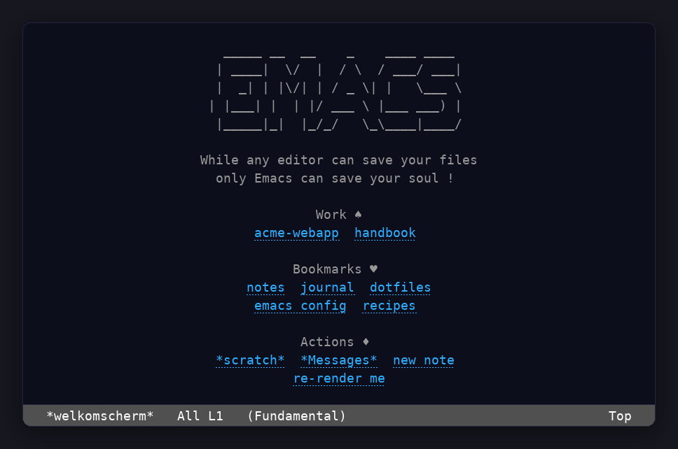
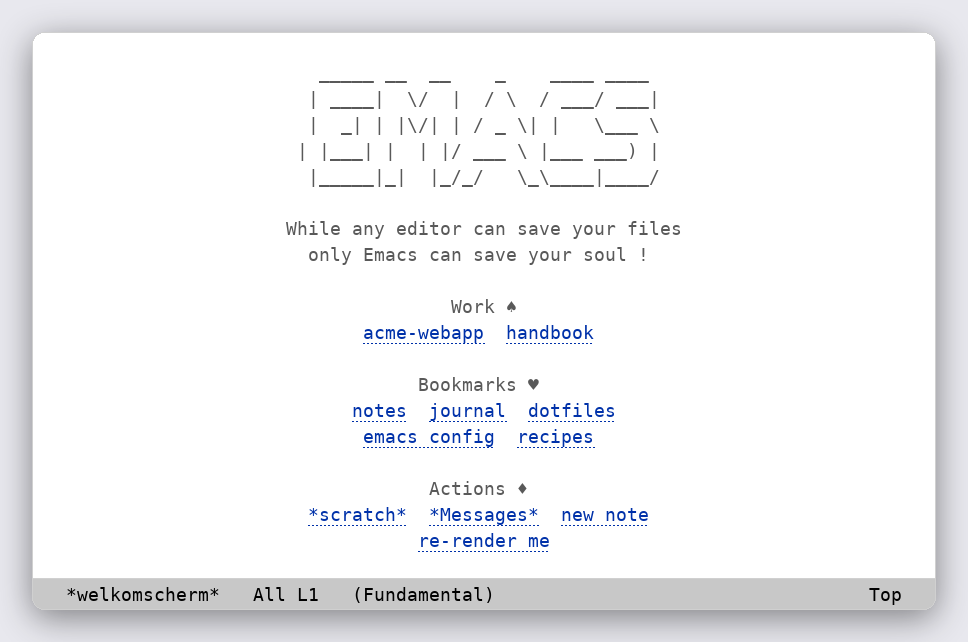
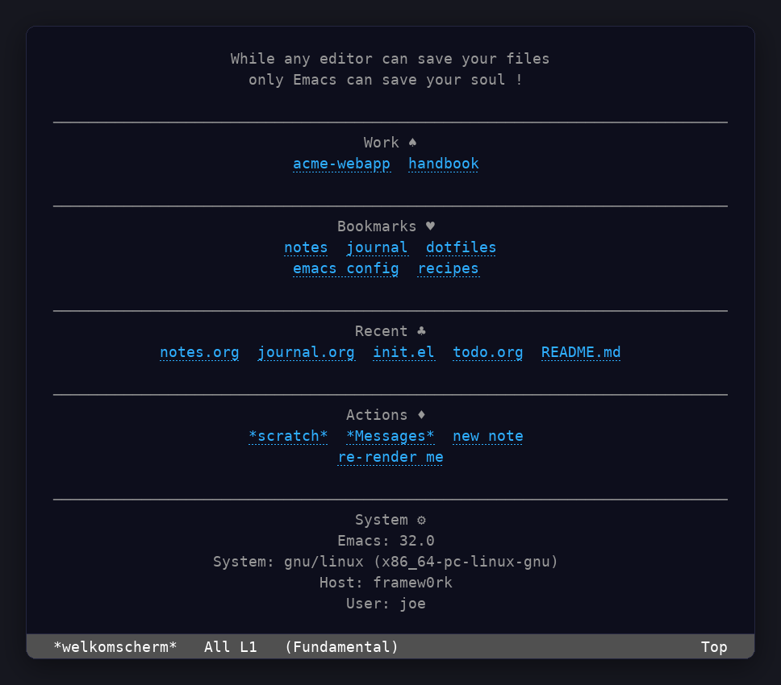
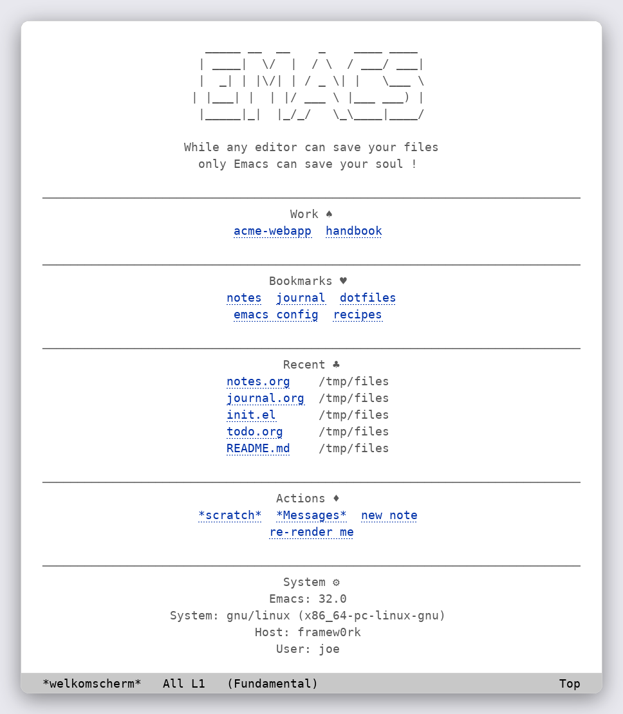

#+title: Testing, releases and screenshots
#+email: jjbigorra@gmail.com
#+language: en
#+options: toc:nil num:nil

* Testing, releases and screenshots

Part of the [[file:index.org][welkomscherm manual]].

** Running the gate
:PROPERTIES:
:CUSTOM_ID: running-the-gate
:END:

The project ships with an ERT suite in ~test/welkomscherm-test.el~ and a
[[https://codeberg.org/jjba23/maak][Maak]] file.  With ~maak~ installed, a single command runs the whole quality gate
from a clean tree.

#+begin_src shell
  maak
#+end_src

~maak~ on its own runs ~check~, which:

1. byte-compiles the package *and* its test suite with warnings turned into
   errors;
2. enforces ~checkdoc~ through ~test/welkomscherm-checkdoc.el~, which turns
   style findings into a non-zero exit;
3. runs the ERT suite.

Other tasks: ~maak compile~, ~maak test~, ~maak lint~, ~maak clean~,
~maak repl~ (an Emacs with the package loaded, ready for hacking) and
~maak tasks~ (to list them all).

If you prefer plain Emacs, the suite runs on its own too:

#+begin_src shell
  emacs -Q --batch -L . -L test -l test/welkomscherm-test.el \
        -f ert-run-tests-batch-and-exit
#+end_src

The package itself needs no external library at all.  Even the horizontal rules
that separate sections are drawn by welkomscherm itself, with no library: see
~welkomscherm/use-separator~ and ~welkomscherm/separator~.

** Continuous integration
:PROPERTIES:
:CUSTOM_ID: continuous-integration
:END:

On GitHub, [[https://github.com/jjba23/welkomscherm.el/actions][GitHub Actions]]
runs the same gate without ~maak~ installed: every push and pull request runs
the ERT suite on Emacs 28.2, 29.4 and 30.1, and one lint job compiles with
warnings turned into errors and enforces ~checkdoc~.

** Cutting a release
:PROPERTIES:
:CUSTOM_ID: cutting-a-release
:END:

Publishing is the tag.  In order:

1. Run the gate on a clean tree (~maak~, or the three commands above), and
   record the output: nothing is released from a red suite.
2. Write the release notes: move the ~* Unreleased~ entries of ~NEWS.org~
   under a dated ~* X.Y.Z~ heading, using the SemVer rule (breaking change is
   major, a new feature minor, a fix patch).
3. Set the version in one place first — the ~;;; Version:~ header of
   ~welkomscherm.el~, which ~default.nix~ reads — and mirror it in the
   packaging recipes (~packaging/arch/PKGBUILD~,
   ~packaging/opensuse/emacs-welkomscherm.spec~,
   ~packaging/debian/changelog~).
4. Commit, then create an annotated tag and push both:

   #+begin_src shell
     git tag -a vX.Y.Z -m "welkomscherm.el X.Y.Z"
     git push origin trunk
     git push origin vX.Y.Z
   #+end_src

5. The ~release~ workflow runs the suite again from the tagged commit, builds
   ~welkomscherm.el-X.Y.Z.tar.gz~ with ~git archive~, and attaches it to a
   GitHub release whose notes are generated from the commits.
6. Once the release exists, pin the Arch checksum to the published archive,
   which is what the ~PKGBUILD~ downloads:

   #+begin_src shell
     curl -L -o /tmp/welkomscherm.tar.gz \
       https://github.com/jjba23/welkomscherm.el/archive/vX.Y.Z.tar.gz
     sha256sum /tmp/welkomscherm.tar.gz
   #+end_src

   Commit the new ~sha256sums~ value separately, after the release.

** Showcase and screenshots
:PROPERTIES:
:CUSTOM_ID: showcase-and-screenshots
:END:

Default view, both themes:

Everything on, both themes:

These pictures are generated from the real thing, not mocked up:
~screenshots/capture.el~ renders the package in a batch Emacs and dumps the
buffer — text, styling runs and all — and ~screenshots/render.py~ paints that
output with the Modus themes' own palette.  (The mode line is drawn by the
renderer, and the startup-time section is left out, because a batch render has
no meaningful startup time to report.  A batch Emacs has no display either, so
the pictures show the screen as a terminal does, without the banner; a GUI
frame puts Emacs's own splash logo there instead.)  Regenerate them with Emacs,
and with
Python 3 and [[https://python-pillow.org/][Pillow]]:

#+begin_src shell
  emacs -Q --batch -L . -l screenshots/capture.el screenshots/out
  python3 screenshots/render.py
#+end_src

And here are two screenshots of the real thing in its natural habitat, taken
from a live Emacs session:

[[https://jointhefreeworld.org/static-assets/welkomscherm/2025-06-18-small-2.png]]

[[https://jointhefreeworld.org/static-assets/welkomscherm/2025-06-18-small.png]]

** Contributing
:PROPERTIES:
:CUSTOM_ID: contributing
:END:

Contributing to free software is a uniquely beautiful act because it embodies
principles of generosity, collaboration, and empowerment.

We welcome everyone to feel invited to the welkomscherm.el project, and
encourage active contribution in all forms, to improve it and/or suggest
improvements, brainstorm with me, make it more modular/flexible, etc, feel free
to contact me <jjbigorra@gmail.com> to chat, discuss or report feedback.

You do not need to write code to help.  Any of these counts:

- *Report a bug* :: a sentence, an Emacs version and, if you can, the contents
  of the ~*welkomscherm*~ buffer is plenty.
- *Suggest a section* :: send the ~welkomscherm/make-section~ form you wish
  existed; it may land in the defaults.
- *Improve the words* :: this manual, the README, the docstrings and the
  comments in the source all count as code here, and are just as worth
  polishing.
- *Send a patch* :: run ~maak~ first — it byte-compiles with warnings as
  errors, enforces ~checkdoc~ and runs the tests — then open a pull request, or
  mail the patch if you prefer.
- *Spread the word* :: tell someone who has been meaning to try Emacs.

Find here the Backlog and Kanban boards for my Emacs packages:
https://lucidplan.jointhefreeworld.org/tickets/emacs-pkg

If you like my work, please support me by
[[https://bmc.link/jjbigorra][buying me a cup of coffee ☕]] so I can continue
with a lot of motivation.

** Code of conduct
:PROPERTIES:
:CUSTOM_ID: code-of-conduct
:END:

This project adheres to the jointhefreeworld code of conduct.  Find it here:

https://jointhefreeworld.org/blog/articles/personal/jointhefreeworld-code-of-conduct/index.html

In summary, we foster an inclusive, respectful, and cooperative environment for
all contributors and users of this free software project.  Inspired by the
ideals of the GNU Project, we strive to uphold freedom, equality, and community
as guiding principles.  We believe that collaboration in a community of mutual
respect is essential to creating excellent free software.
